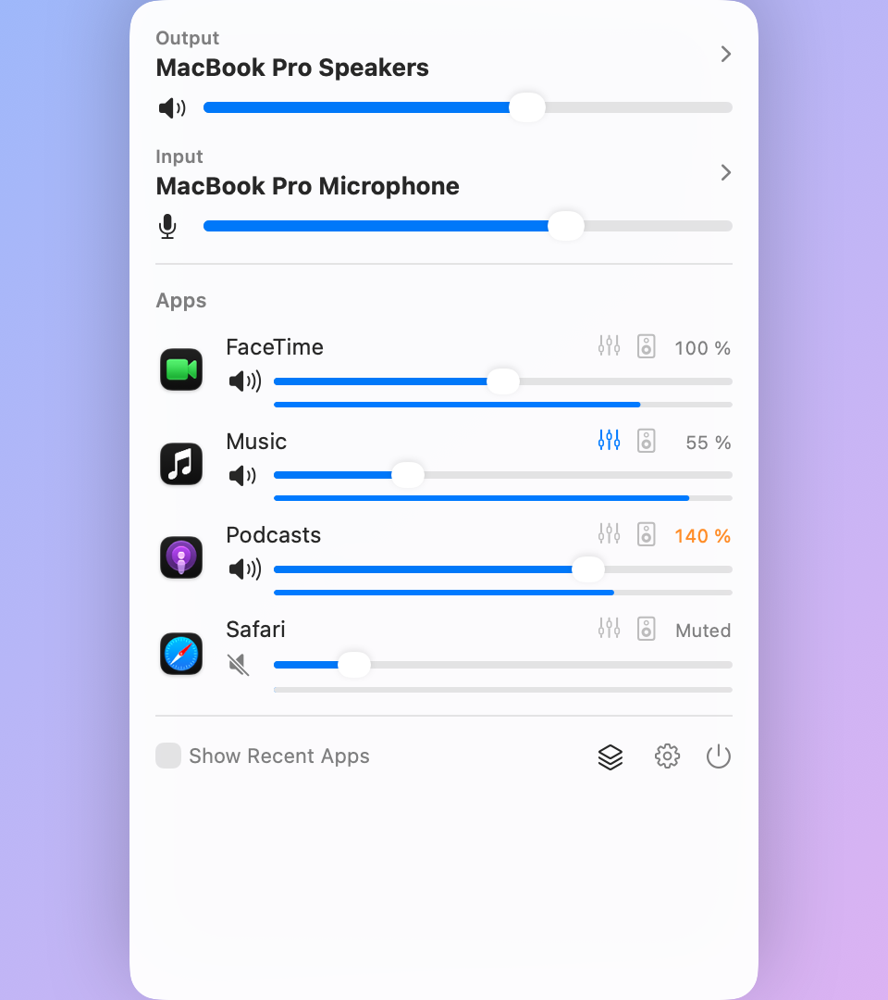
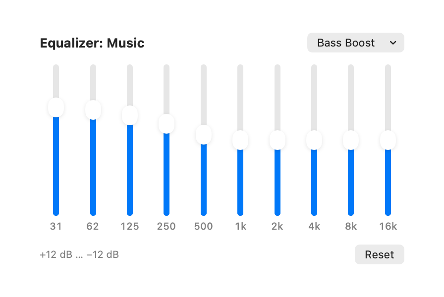

> ## ⚠️ Disclaimer
>
> This App is:
>
> - **Vibecoded**: written with AI assistance. I can't read or write code and don't know exactly what the AI wrote.
> - **Open source**: free to read, use, and modify
> - **Collecting no data**: my apps are not meant to collect any data, and I never will intentionally collect any
> - **Experimental**: they may be buggy, incomplete, or break without notice
>
> **Use at your own risk.** There is no warranty of any kind.
> When in doubt, have your own AI or yourself review the code before you run anything.
>
> **Found a problem?** If you can show that one of my apps collects data or has bugs, open an issue or send a commit. I will fix it right away.

<div align="center">


# Volume Rocker

**Per-app volume control for your Mac, designed to feel like Apple built it.**

[](https://github.com/printMoney/volume-rocker/actions/workflows/ci.yml)
[](LICENSE)


<picture>
  <source media="(prefers-color-scheme: dark)" srcset="docs/images/hero-dark.png">
  
</picture>

</div>

Turn down a noisy browser tab without touching your music. Boost a quiet podcast. Send a call to your headset while music keeps playing on the speakers. Volume Rocker lives in your menu bar and gives every app its own volume, with no audio drivers to install.

## Features

**The mixer**
- 🎚️ **Per-app volume and mute**, with live level meters showing which app is making noise.
- 🔊 **Boost up to 200%** with a built-in limiter, so quiet videos get louder without distortion.
- 🎛️ **10-band equalizer per app** with presets like Bass Boost, Vocal, Spoken Word and Late Night.
- 🔀 **Per-app output routing:** calls on the headset, music on the speakers.
- 🧠 **Remembers everything:** each app's volume, EQ and routing come back automatically, optionally per output device.
- 💾 **Profiles** such as Work, Gaming and Movie, switched with one click or a keyboard shortcut.

**Devices**
- 🎧 **One-click switching** between speakers, AirPods and other Bluetooth devices, HDMI, DisplayPort, USB and AirPlay, for output and input.
- 🔌 Handles devices coming and going, sleep and wake, and sample-rate changes without going silent.

**Everywhere on your Mac**
- 🖱️ **Scroll on the menu bar icon** to change the volume; **Option-click** it for devices and profiles.
- ⌨️ **Global keyboard shortcuts** for the mixer, mute, volume and every profile.
- 🗣️ **Shortcuts and Siri:** set an app's volume, mute an app, switch the output, apply a profile.
- 🎛️ **Control Center controls** on macOS 26: Mute Sound, Next Profile, Open Volume Rocker.
- 🔄 **Automatic updates**, signed and verified, and **open at login**.

**Built right**
- 🪶 **Light:** about 0.3% CPU at idle, about 1.4% while processing audio, about 32 MB of memory. ([How this was measured](docs/PERFORMANCE.md))
- 🛡️ **No drivers, no kernel extensions:** built on Apple's Core Audio process taps. Uninstalling means deleting the app.
- ♿ **Accessible:** full VoiceOver and keyboard support; respects Reduce Motion, Reduce Transparency and Increase Contrast.
- ✨ **Native:** SwiftUI, system fonts and colors, light and dark mode, Liquid Glass on macOS 26.

<p align="center">
  <picture>
    <source media="(prefers-color-scheme: dark)" srcset="docs/images/equalizer-dark.png">
    
  </picture>
</p>

## Requirements

- A Mac with **Apple Silicon** (M1 or newer)
- **macOS 15 Sequoia** or newer. Control Center controls need macOS 26 Tahoe.

## Install

### Download

1. Download the latest `VolumeRocker-x.y.z.dmg` from [Releases](https://github.com/printMoney/volume-rocker/releases/latest).
2. Open it and drag **Volume Rocker** into **Applications**.
3. Open Volume Rocker. A short welcome explains the one permission it needs, and then its icon appears in the menu bar.

### Homebrew

```bash
brew tap printmoney/tap
```

```bash
brew trust printmoney/tap
```

```bash
brew install --cask volume-rocker
```

Homebrew asks you to trust a third-party tap once. Update later with `brew upgrade --cask volume-rocker`.

### "Apple could not verify…" (unsigned builds)

Until releases are signed and notarized with a paid Apple Developer account, macOS will warn you the first time you open the app. To open it anyway:

1. Try to open Volume Rocker once, then click **Done** on the warning.
2. Open **System Settings → Privacy & Security**, scroll down, and click **Open Anyway** next to the Volume Rocker message.
3. Confirm with your password or Touch ID.

Alternatively, run this once in Terminal:

```bash
xattr -dr com.apple.quarantine "/Applications/Volume Rocker.app"
```

Notarized builds don't need any of this.

## Using it

| To… | Do this |
| --- | --- |
| Change an app's volume | Click the speaker icon in the menu bar and drag the app's slider |
| Mute an app | Click the speaker next to its slider |
| Use the equalizer | Click the slider icon in the app's row |
| Play an app on another device | Click the speaker-box icon in the app's row |
| Switch output or input | Click the device name at the top of the panel, or Option-click the menu bar icon |
| Change the volume quickly | Scroll over the menu bar icon |
| Save a profile | Click the stack icon at the bottom → **Save Current Mix…** |
| See quiet apps too | Tick **Show Recent Apps** |
| More options | Right-click an app, or open **Settings** with the gear icon |

## Why does it ask for "System Audio Recording" permission?

To change one app's volume, macOS requires Volume Rocker to *tap* into that app's audio stream, adjust it, and play it back. Apple groups this ability under the **System Audio Recording** permission.

- Audio is processed **in real time on your Mac** and is never saved, recorded or sent anywhere.
- Volume Rocker only goes online to check for updates.
- It **never** asks for microphone access. Changing the input volume doesn't need it.
- You can revoke the permission at any time in **System Settings → Privacy & Security → Screen & System Audio Recording**.

## Build from source

You need Xcode 26 or newer and [Homebrew](https://brew.sh).

```bash
brew install xcodegen swiftlint swiftformat
```

```bash
git clone https://github.com/printMoney/volume-rocker.git
```

```bash
cd volume-rocker && xcodegen generate && open VolumeRocker.xcodeproj
```

Then press **⌘R** in Xcode. To run the same checks as CI (lint, zero-warning build, tests):

```bash
Scripts/test.sh
```

See [CONTRIBUTING.md](CONTRIBUTING.md) and [docs/ARCHITECTURE.md](docs/ARCHITECTURE.md) for how everything fits together.

## FAQ

**Does it need a virtual audio driver like other mixers?**
No. Volume Rocker uses Core Audio *process taps*, which Apple added in macOS 14.4. Nothing is installed into the system.

**Does it work with AirPods, Bluetooth, HDMI and AirPlay?**
Yes, with any output device macOS can play to. To pick a specific AirPlay speaker, use Control Center; Volume Rocker then treats it like any other device.

**Does it add latency?**
About one audio buffer (roughly 10–20 ms). That isn't noticeable for music, video or calls. For rhythm games or live music production, add those apps to **Settings → Apps → Excluded Apps** so they bypass the mixer.

**What happens if Volume Rocker quits or crashes?**
Your apps simply play at their normal volume again. macOS removes Volume Rocker's audio connections together with the app, so sound is never left silent.

**Does it use private APIs?**
Two small ones, both loaded carefully so the app keeps working if they ever disappear. One checks the audio permission before taking over an app's sound, because a missing permission would otherwise silence it. The other finds which app a helper process belongs to (for example, Safari's sound is played by a WebKit process). Details are in [docs/ARCHITECTURE.md](docs/ARCHITECTURE.md).

**Why Apple Silicon only?**
It keeps the app small and fast, and lets the audio code be tuned for one architecture.

**How do I uninstall it?**
Quit it from the panel (power button) and drag it to the Trash. Its settings live in `~/Library/Preferences/io.github.printmoney.VolumeRocker.plist`.

## Credits

- [Sparkle](https://sparkle-project.org) for updates
- [KeyboardShortcuts](https://github.com/sindresorhus/KeyboardShortcuts) by Sindre Sorhus
- Equalizer filters from Robert Bristow-Johnson's *Audio EQ Cookbook*
- Apple's [Capturing system audio with Core Audio taps](https://developer.apple.com/documentation/coreaudio/capturing-system-audio-with-core-audio-taps) sample

## License

[MIT](LICENSE) © Volume Rocker contributors
