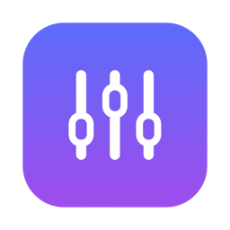

<div align="center">



# Volume Rocker

**Per-app volume control for your Mac, designed to feel like Apple built it.**

[](https://github.com/printMoney/volume-rocker/actions/workflows/ci.yml)
[](LICENSE)


<!-- HERO: replace with a screenshot or GIF of the mixer panel (docs/images/hero.png, about 1600 px wide) -->


</div>

> [!NOTE]
> Volume Rocker is in early development. See the [roadmap](ROADMAP.md) for what works today.

## Features

- 🎚️ **Per-app volume and mute.** Turn down the browser without touching your music.
- 📊 **Live level meters.** See which app is making noise.
- 🧠 **Remembers your mix.** Each app's volume is restored automatically, even after a restart.
- 🎧 **One-click device switching.** Speakers, AirPods, HDMI, USB and AirPlay, for both output and input.
- 🔊 **Boost to 200%** with a soft limiter, so quiet videos get louder without distortion.
- 🔀 **Per-app routing.** Send calls to your headset and music to your speakers.
- 🎛️ **10-band EQ per app** with presets.
- 💾 **Profiles** such as Work, Gaming and Movie, switchable from the menu or with a shortcut.
- ⌨️ **Global keyboard shortcuts** for the mixer, mute, volume and profiles.
- 🖱️ **Scroll on the menu bar icon** to change the volume; Option-click it for devices and profiles.
- 🗣️ **Shortcuts and Siri actions:** set an app's volume, mute an app, switch output, apply a profile.
- 🎛️ **Control Center controls** on macOS 26: Mute Sound, Next Profile, Open Volume Rocker.
- 🔄 **Automatic updates**, signed and verified, plus open at login.
- 🪶 **Lightweight.** Under 1% CPU at idle and under 50 MB of memory. No drivers, no kernel extensions.
- ♿ **Accessible.** Full VoiceOver and keyboard support, and it respects Reduce Motion and Reduce Transparency.

## Requirements

- A Mac with **Apple Silicon** (M1 or newer)
- **macOS 15 Sequoia** or newer. On macOS 26 Tahoe it uses the Liquid Glass look.

## Install

### Download

1. Download the latest `VolumeRocker-x.y.z.dmg` from [Releases](https://github.com/printMoney/volume-rocker/releases/latest).
2. Open it and drag **Volume Rocker** into **Applications**.
3. Open Volume Rocker. Its icon appears in the menu bar.

### Homebrew

```bash
brew install --cask printmoney/tap/volume-rocker
```

### "Apple could not verify…" (unsigned builds)

Until releases are signed and notarized with a paid Apple Developer account, macOS will warn you the first time you open the app. To open it anyway:

1. Try to open Volume Rocker once, then click **Done** on the warning.
2. Open **System Settings → Privacy & Security**, scroll down, and click **Open Anyway** next to the Volume Rocker message.
3. Confirm with your password or Touch ID.

Alternatively, run this once in Terminal:

```bash
xattr -dr com.apple.quarantine "/Applications/Volume Rocker.app"
```

Notarized builds don't need any of this.

## Why does it ask for "System Audio Recording" permission?

To change one app's volume, macOS requires Volume Rocker to *tap* into that app's audio stream, adjust it, and play it back. Apple groups this ability under the **System Audio Recording** permission.

- Audio is processed **in real time on your Mac** and is never saved, recorded or sent anywhere.
- Volume Rocker has **no network access** except for checking for updates.
- It **never** asks for microphone access unless you turn on an input feature yourself.
- You can revoke the permission at any time in **System Settings → Privacy & Security → Screen & System Audio Recording**.

## Build from source

You need Xcode 26 or newer and [Homebrew](https://brew.sh).

```bash
brew install xcodegen swiftlint swiftformat
```

```bash
git clone https://github.com/printMoney/volume-rocker.git
```

```bash
cd volume-rocker && xcodegen generate && open VolumeRocker.xcodeproj
```

Then press **⌘R** in Xcode. To run the same checks as CI (lint, zero-warning build, tests):

```bash
Scripts/test.sh
```

See [CONTRIBUTING.md](CONTRIBUTING.md) and [docs/ARCHITECTURE.md](docs/ARCHITECTURE.md) for how everything fits together.

## FAQ

**Does it need a virtual audio driver like other mixers?**
No. Volume Rocker uses Core Audio *process taps*, which Apple added in macOS 14.4. Nothing is installed into the system, and uninstalling means deleting the app.

**Does it work with AirPods, Bluetooth, HDMI and AirPlay?**
Yes. It works with any output device macOS can play to.

**Does it add latency?**
It adds a few milliseconds at most, which isn't noticeable for music, video or calls.

**Why Apple Silicon only?**
It keeps the app small and fast, and lets the audio code be tuned for one architecture.

**How do I uninstall it?**
Quit it from the menu and drag it to the Trash. Settings live in `~/Library/Preferences/io.github.printmoney.VolumeRocker.plist`.

## Credits

- [Sparkle](https://sparkle-project.org) for updates
- [KeyboardShortcuts](https://github.com/sindresorhus/KeyboardShortcuts) by Sindre Sorhus
- Equalizer filters from Robert Bristow-Johnson's *Audio EQ Cookbook*
- Apple's [Capturing system audio with Core Audio taps](https://developer.apple.com/documentation/coreaudio/capturing-system-audio-with-core-audio-taps) sample

## License

[MIT](LICENSE) © Volume Rocker contributors
