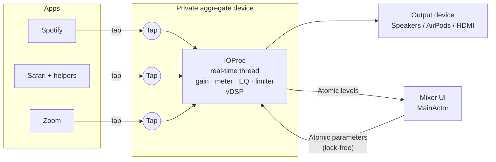

# Architecture

This document explains how Volume Rocker changes the volume of individual apps without a virtual audio driver.

## The big picture

macOS 14.4 added **process taps**: a way to capture the audio an app is about to play. Volume Rocker uses them like this:

1. **Tap and mute the original.** For each output device, Volume Rocker creates a tap (`CATapDescription` + `AudioHardwareCreateProcessTap`) on the apps playing to that device, with `muteBehavior = .mutedWhenTapped`. The apps' sound no longer reaches the speakers directly, but Volume Rocker receives it.
2. **Wrap the device in a private aggregate device.** A private aggregate device (`AudioHardwareCreateAggregateDevice`, `kAudioAggregateDeviceIsPrivateKey = true`) combines the real output device with the taps. It is invisible to other apps and disappears when Volume Rocker quits.
3. **Process and play.** An IOProc on the aggregate device runs on Core Audio's real-time thread. It reads each tapped app's audio, applies that app's gain (and later EQ and limiting), adds the results together and writes them to the real device's output.

## Modules

| Folder | Responsibility | Thread |
| --- | --- | --- |
| `App/` | Entry point, app lifecycle | Main |
| `ProcessMonitor/` | Watches `kAudioHardwarePropertyProcessObjectList` and each process's `kAudioProcessPropertyIsRunningOutput`; groups helpers (e.g. "Google Chrome Helper") under their parent app | Main + Core Audio listener queue |
| `DeviceManager/` | Lists devices, default device, system volume/mute, connect/disconnect, sleep/wake | Main + listener queue |
| `AudioEngine/` | Creates taps and aggregate devices; owns the real-time IOProc | **Real-time** (IOProc) + main (setup) |
| `Persistence/` | Per-app and per-device settings and profiles (`UserDefaults`, Codable) | Main |
| `UI/` | SwiftUI menu panel, Settings, onboarding | Main |

Models are `@Observable` and isolated to the `MainActor`. The project compiles in Swift 6 language mode with complete strict-concurrency checking.

## The real-time rules

Core Audio calls the IOProc every few milliseconds, with a hard deadline. If it is late, you hear a click. Inside the IOProc Volume Rocker therefore **never**:

- allocates or frees memory (no `Array` growth, no `String`, no class instances),
- takes a lock or waits on anything,
- calls `async` code, logs, or touches Objective-C objects.

Instead:

- **Parameters in:** each app's target gain, mute and EQ settings live in `Atomic` values from the Swift `Synchronization` module. The UI writes them; the audio thread reads them.
- **Levels out:** the audio thread writes peak and RMS levels into `Atomic` values, and the UI reads them about 30 times per second while the panel is open.
- **No zipper noise:** the gain never jumps. Each buffer ramps linearly from the previous gain to the new target (`vDSP_vrampmul`), so moving a slider is perfectly smooth.
- **Pre-allocated buffers:** scratch buffers are sized when the aggregate device starts and when the sample rate or buffer size changes, never inside the callback.
- **Math with Accelerate:** gain, mixing, metering and biquad EQ all use vDSP.

## Lifecycle and robustness

- **Device changes:** when the default output device changes, a device disappears, or the sample rate changes, the affected aggregate device is torn down and rebuilt on the main actor while the IOProc is stopped.
- **Sleep/wake:** the engine is paused on `NSWorkspace.willSleepNotification` and rebuilt on wake.
- **Crash safety:** private aggregate devices and taps belong to the Volume Rocker process. If it crashes or quits, macOS removes them and the apps play normally again, so audio is never left silent.

## Permissions

Process taps need the **System Audio Recording** permission (`NSAudioCaptureUsageDescription`). macOS shows the prompt the first time a tap is created. Volume Rocker explains why on an onboarding screen first. Microphone access is never requested unless an input feature is turned on.
