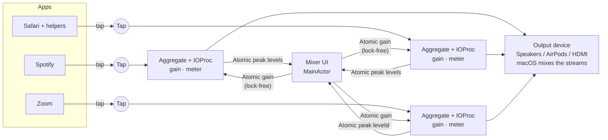

# Architecture

This document explains how Volume Rocker changes the volume of individual apps without a virtual audio driver.

## The big picture

macOS 14.4 added **process taps**: a way to capture the audio an app is about to play. Volume Rocker uses them like this:

1. **Tap and mute the original.** For each app that is playing, Volume Rocker creates a private tap (`CATapDescription(stereoMixdownOfProcesses:)` + `AudioHardwareCreateProcessTap`) covering all of that app's processes, with `muteBehavior = .mutedWhenTapped`. The app's sound no longer reaches the speakers directly, but Volume Rocker receives it.
2. **Wrap the device in a private aggregate device.** A private aggregate device (`AudioHardwareCreateAggregateDevice`, `kAudioAggregateDeviceIsPrivateKey = true`) combines the device the app was playing to with the tap. It is invisible to other apps and disappears when Volume Rocker quits.
3. **Process and play.** An IOProc on the aggregate device runs on Core Audio's real-time thread. It reads the app's audio, applies the app's gain (and later EQ and limiting), and writes it to the real device's output. macOS mixes the output of all apps' aggregate devices together.

### Why one aggregate device per app (not per output device)

The original plan was one aggregate device per output device, holding every app's tap. But changing an aggregate device's tap list means stopping and restarting its audio, so every time *any* app started or stopped playing, *all* apps would drop out for a moment. With one small aggregate device per app, apps start and stop independently, and per-app output routing (Phase 3) only needs a different sub-device. The cost is one extra Core Audio IO thread per playing app, which is cheap: each one only copies and scales a buffer with vDSP.

## Modules

| Folder | Responsibility | Thread |
| --- | --- | --- |
| `App/` | Entry point, `MixerModel` (turns state into tap requests), `AppAudioItem` | Main |
| `CoreAudioSupport/` | Typed property reading/writing and listener helpers | Main |
| `ProcessMonitor/` | Watches `kAudioHardwarePropertyProcessObjectList` and each process's `kAudioProcessPropertyIsRunningOutput`; groups helpers (e.g. "Google Chrome Helper") under their parent app | Main + Core Audio listener queue |
| `DeviceManager/` | Lists devices, default device, system volume/mute, connect/disconnect, sleep/wake | Main + listener queue |
| `AudioEngine/` | `AudioEngine` actor creates taps and aggregate devices; `TapRenderState` is the real-time render code | **Real-time** (IOProc) + engine actor (setup) |
| `Persistence/` | Per-app and per-device settings and profiles (`UserDefaults`, Codable) | Main |
| `UI/` | SwiftUI menu panel, Settings, onboarding | Main |

Models are `@Observable` and isolated to the `MainActor`. The project compiles in Swift 6 language mode with complete strict-concurrency checking.

## The real-time rules

Core Audio calls the IOProc every few milliseconds, with a hard deadline. If it is late, you hear a click. Inside the IOProc Volume Rocker therefore **never**:

- allocates or frees memory (no `Array` growth, no `String`, no class instances),
- takes a lock or waits on anything,
- calls `async` code, logs, or touches Objective-C objects.

Instead:

- **Parameters in:** each app's target gain, mute and EQ settings live in `Atomic` values from the Swift `Synchronization` module. The UI writes them; the audio thread reads them.
- **Levels out:** the audio thread writes peak and RMS levels into `Atomic` values, and the UI reads them about 30 times per second while the panel is open.
- **No zipper noise:** the gain never jumps. Each buffer ramps linearly from the previous gain to the new target (`vDSP_vrampmul`), so moving a slider is perfectly smooth.
- **Pre-allocated buffers:** scratch buffers are sized when the aggregate device starts and when the sample rate or buffer size changes, never inside the callback.
- **Math with Accelerate:** gain, mixing, metering and biquad EQ all use vDSP.

## How the pieces talk

The engine is **declarative**. Whenever anything changes (an app starts or stops playing, the permission changes, the output device changes), `MixerModel` builds the complete list of taps that *should* exist (`[TapRequest]`) and hands it to the `AudioEngine` actor. The engine compares it with what is running, then stops, starts or restarts sessions to match. Calls are serialized, so an older list can never overwrite a newer one. Slow Core Audio setup calls run on the actor, never on the main thread.

A tap is kept for 30 seconds after an app goes quiet, so pausing and resuming doesn't rebuild it.

Volume changes don't go through the engine at all. The slider writes the new gain straight into that app's `TapRenderState` atomic, and the next audio buffer ramps to it.

## Apple API notes (things that behave differently than documented)

- **"Is running output" notifications don't arrive.** Listening for `kAudioProcessPropertyIsRunningOutput` changes on a process object never fires (tested on macOS 27). `kAudioProcessPropertyIsRunning` does fire, and by then the output flag is already up to date, so `AudioProcessMonitor` listens to both and re-reads.
- **There is no public API to check the System Audio Recording permission.** Without the permission, a tap still "works" but delivers silence while muting the app, which would silence the user's apps. Volume Rocker therefore checks it through the TCC framework's `TCCAccessPreflight`/`TCCAccessRequest`, loaded dynamically (the same approach as the well-known AudioCap sample). If those functions disappear, the app falls back to the system prompt.
- **Helper processes.** Browsers play sound from helper processes. Chrome's helpers live inside `Google Chrome.app`, so the outermost `.app` in the executable path identifies the app. Safari's audio comes from WebKit's GPU process, which lives outside Safari. For that case macOS's "responsible process" (looked up with `responsibility_get_pid_responsible_for_pid`, also loaded dynamically) points back to Safari.
- **Taps always deliver 48 kHz.** The tap's format is 48 kHz stereo even when the app plays to a 44.1 kHz device, and pinning the tap to a device (`CATapDescription.deviceUID`) doesn't change that. The aggregate device's drift compensation converts the rate, and the IOProc receives equal frame counts for input and output. But a tap entry without an explicit `kAudioSubTapDriftCompensationQualityKey` uses a low-quality converter, which was audible as distortion on 44.1 kHz Bluetooth headphones. Volume Rocker requests `kAudioAggregateDriftCompensationMaxQuality`, at about 1% CPU per playing app.
- **Headsets with microphones.** An aggregate device built on AirPods also contains their microphone, which could switch Bluetooth into low-quality call mode. The engine marks those input streams as unused for its IOProc (`kAudioDevicePropertyIOProcStreamUsage`).

## Lifecycle and robustness

- **Device switching:** choosing a device in the panel sets the system default (`kAudioHardwarePropertyDefaultOutputDevice`/`…InputDevice`), exactly like Control Center. If alerts were following the default output, they move too.
- **Device changes:** when an app moves to another output device, or the default output device changes, its tap request changes and the engine rebuilds that app's aggregate device. Each request uses the app's device only if it's still in the device list and is a real output device. Otherwise (disconnected, or an automatic voice-processing aggregate) it falls back to the default output.
- **Device list:** `AudioDeviceList` watches `kAudioHardwarePropertyDevices` and hides hidden devices, our own private aggregates and devices that can't be the default.
- **Sample-rate changes:** `AudioDeviceList` watches each output device's nominal sample rate. When one changes, the taps on that device are rebuilt by bumping a per-device *generation* number in their `TapRequest`s.
- **Sleep/wake:** on `NSWorkspace.willSleepNotification` every tap is released, so apps play normally and devices can sleep. Two seconds after wake (so Bluetooth can reconnect), the global generation is bumped and all taps are rebuilt.
- **Core Audio restarts:** if `coreaudiod` restarts (`kAudioHardwarePropertyServiceRestarted`), every object ID is stale, so all monitors, controllers and taps start over.
- **Per-device memory (optional):** with "Remember app volumes for each output device" on, settings are stored as `"<device UID>|<bundle ID>"`. A new device starts from the app's general setting.
- **Crash safety:** private aggregate devices and taps belong to the Volume Rocker process. If it crashes or quits, macOS removes them and the apps play normally again, so audio is never left silent.

## Permissions

Process taps need the **System Audio Recording** permission (`NSAudioCaptureUsageDescription`). macOS shows the prompt the first time a tap is created. Volume Rocker explains why on an onboarding screen first. Microphone access is never requested unless an input feature is turned on.
